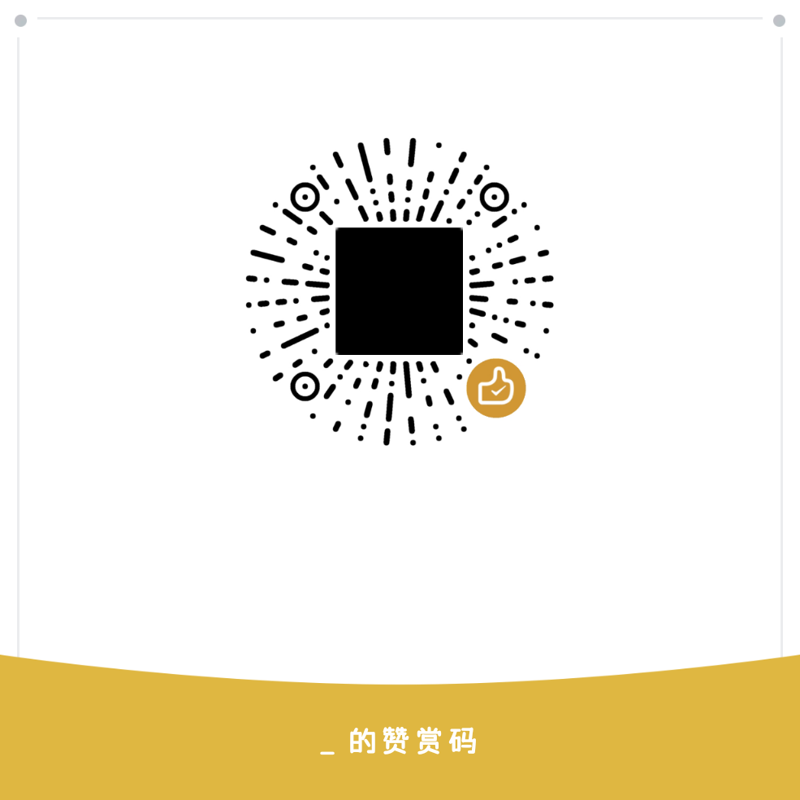

# FusionBlock

> 一套给 AdGuard 用的中文广告拦截规则：主列表合并七个上游源，隐私、钓鱼、白名单各取专用清单，去掉重复和会误伤常用服务的规则，每八小时自动重建。

在线介绍页（可一键添加到 AdGuard）：<https://liu134921.github.io/FusionBlock/>

## 这是什么

不是从零写规则，而是把一直在维护的公开源合到一起：去掉重复的、去掉被父域规则完全覆盖的、把会拦掉整个后缀的宽泛规则单独处理，再补一份「别拦我」的白名单。具体怎么合，见 [AGENTS.md](AGENTS.md)。

起因是一次微信收不到图片。查出来是列表里一条 `||wxs.qq.com^` 把整个域拦了——图片、头像、表情全走这里，而好几个国内合并列表都带着这条规则。换列表躲不掉，只能在构建时剔掉。

## 它拦什么，不拦什么

拦：网页横幅、App 开屏、视频贴片、统计埋点、跨站追踪、已知的钓鱼和诈骗域名。

不拦：微信、支付宝、淘宝、京东、B 站、抖音、网易云、高德这些常用服务的正常请求。每次构建前拿 42 个关键域名撞一遍，哪个子域被拦会写进报告。

不适用：Clash、Surge、Quantumult、hosts 这类工具。这里是 AdGuard / Adblock Plus 语法（`||域名^`、`@@` 例外、`##` 元素隐藏），导进上面那些工具不会报错，但也不会有任何效果。

## 文件

| 文件 | 内容 | 规模 | 建议 |
|---|---|---|---|
| `FusionBlock-Ads.txt` | 广告拦截主列表，含元素隐藏规则 | 20.9 万行 / 8.5 MB | 建议开 |
| `FusionBlock-Privacy.txt` | 隐私与追踪拦截（来自 EasyPrivacy） | 5.6 万行 / 2.1 MB | 建议开 |
| `FusionBlock-Phishing.txt` | 钓鱼、仿冒登录页 | 4.6 万行 / 2.1 MB | 建议开 |
| `FusionBlock-Whitelist.txt` | 例外规则：uBlock Unbreak + AdGuard / EasyList 官方过滤器内嵌例外 | 7,389 条 / 412 KB | 必开 |

白名单和其他几份一样，是当过滤器订阅加的，不用手动往用户规则里粘。它只放行、不拦截，内容全部来自别人维护的现成清单：uBlock 的 Unbreak，加上 AdGuard 和 EasyList 在自己过滤器里内嵌的例外。

仓库里还有一个 `FusionBlock-Extra-CN.txt`，是 anti-AD 那份单独打的包，不列在推荐里，也不建议启用——覆盖更多，误杀也明显更多。

## 安装

### AdGuard for Android

1. 打开 AdGuard → 设置 → 过滤器 → 自定义过滤器
2. 点 `+` → 按 URL 添加，把下面「订阅地址」里的地址逐条加进去
3. 白名单那份别漏，它的优先级最高
4. 如果你之前叠了别的列表，建议只留这几份生效，叠太多是误杀的主要来源
5. 重启一次 AdGuard，让它重建索引

第一次加载 8.5 MB 的列表会卡几秒，AdGuard 建完缓存之后就正常了。

### AdGuard Home

过滤器 → DNS 黑名单 → 添加订阅地址，填同样的地址。

### 浏览器扩展版

也能用，但拦不到 App 内的广告，效果有限。

## 订阅地址

四条都用，最后一条是白名单。每块右上角有一个复制图标，点一下就行。

**广告拦截**
```
https://gh-proxy.org/https://raw.githubusercontent.com/Liu134921/FusionBlock/main/FusionBlock-Ads.txt
```

**隐私追踪**
```
https://gh-proxy.org/https://raw.githubusercontent.com/Liu134921/FusionBlock/main/FusionBlock-Privacy.txt
```

**钓鱼站点**
```
https://gh-proxy.org/https://raw.githubusercontent.com/Liu134921/FusionBlock/main/FusionBlock-Phishing.txt
```

**白名单（必加）**
```
https://gh-proxy.org/https://raw.githubusercontent.com/Liu134921/FusionBlock/main/FusionBlock-Whitelist.txt
```

国内直连 GitHub 基本拉不动，所以上面给的是 gh-proxy 加速地址。要用 GitHub 原地址的话：

**GitHub 源**
```
https://raw.githubusercontent.com/Liu134921/FusionBlock/main/FusionBlock-Ads.txt
```

## 更新

GitHub Actions 每八小时跑一次构建（北京时间 08:00 / 16:00 / 次日 00:00 各一次，实际会晚几分钟到半小时），把七个上游拉下来重新合并、化简、体检，然后提交。订阅地址走 gh-proxy 加速，不用变，AdGuard 会按列表头部声明的 `Expires: 7 days` 自己来取。

每次构建会在 `reports/` 留下报告，写明载入时合并掉了多少重复、化简删了多少条、以及 42 个关键域名的体检结果。

## 可选：增强脚本

规则拦不住的东西——检测到你开了广告拦截就弹遮罩、Cookie 横幅赖着不走、点个链接自己跳到广告页——用一个配套的用户脚本处理。在 AdGuard → 设置 → 扩展里添加这个地址：

```
https://liu134921.github.io/FusionBlock/enhance.user.js
```

它做四件事：拆掉「请关闭广告拦截」的遮罩并恢复页面滚动，拦掉没有用户操作的弹窗和跨域自动跳转，把 AMP 页面换回原页面，清掉 Cookie 横幅和固定底部广告条。GitHub、支付宝、12306、几家银行这些不该动的站已经写进白名单。

在某个站上出了问题，从 AdGuard 的扩展菜单选「在这儿出问题了？停用本扩展」，那个域名就不再处理；地址后面加 `?fboff=1` 也能临时关掉这一次。

## 仓库结构

```
FusionBlock-*.txt      成品规则（四份主列表 + Extra-CN）
reports/               构建报告与体检报告
tools/                 合并、化简、体检、构建用的脚本
.github/workflows/     自动构建
assets/                赞赏码
docs/                  介绍页（GitHub Pages）
```

## 遇到问题

[提个 Issue](https://github.com/Liu134921/FusionBlock/issues)，写清这三样就行：

- 哪个网站、哪个 App
- 具体现象：白屏、图片裂、按钮点不动、收不到消息
- 你的 AdGuard 版本

能截图最好。是某个域名被误杀的话，直接在 Issue 里贴域名，加进白名单就能修。

## 赞赏

如果它帮你省了点时间，可以扫码请我喝一杯。完全自愿，不影响任何功能。



## 许可与致谢

脚本部分 MIT，见 [LICENSE](LICENSE)。规则本身不主张著作权，版权归各上游作者。

- [AdGuard Filters](https://github.com/AdguardTeam/AdguardFilters) — Base / Mobile / Chinese
- [EasyList](https://easylist.to/) / [EasyList China](https://github.com/easylist/easylistchina)
- [EasyPrivacy](https://easylist.to/) — 隐私与追踪
- [HaGeZi DNS Blocklists](https://github.com/hagezi/dns-blocklists) — Light
- [217heidai/adblockfilters](https://github.com/217heidai/adblockfilters)
- [xinggsf/Adblock-Plus-Rule](https://github.com/xinggsf/Adblock-Plus-Rule) — 补充广告规则
- [malware-filter](https://gitlab.com/malware-filter/phishing-filter) — 钓鱼站点
- [uBlock Origin uAssets](https://github.com/uBlockOrigin/uAssets) — Unbreak 例外
- [anti-AD](https://github.com/privacy-protection-tools/anti-AD) — 只作为 `FusionBlock-Extra-CN.txt` 单独存放，未纳入主列表，也不推荐启用

本仓库只做合并、去重、化简和体检。发现某条规则本身有问题，也欢迎去上游反馈。